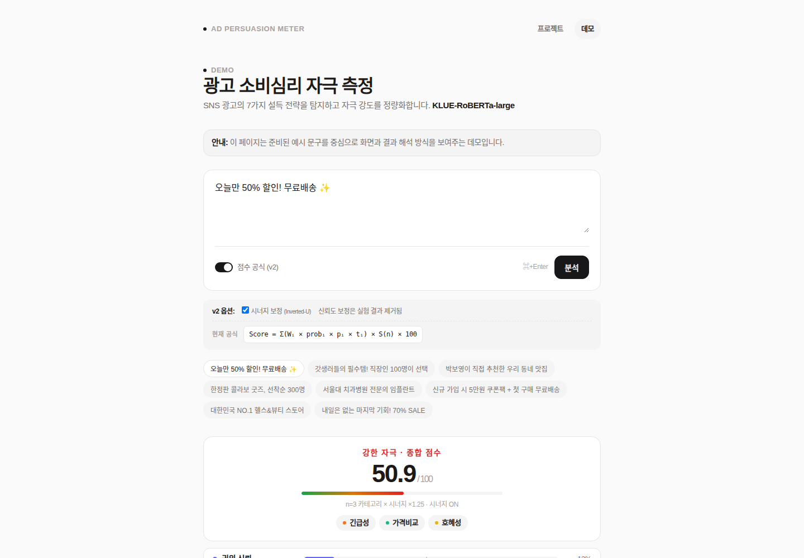

# PL-snsAds

SNS 광고 문구에서 7가지 소비심리 자극을 분류하고, 방향성·강도·조합을 반영해 광고의 설득 전략을 점수로 설명하는 한국어 AI 프로젝트입니다. 광고 텍스트와 이미지에서 추출한 OCR 텍스트를 분석 입력으로 다룹니다.

[프로젝트 사이트](https://pl.kdhoon.me) · [예시 데모](https://pl.kdhoon.me/demo) · [실험 분석](모델학습/실험분석보고서.md)



*2026-09-30 공개 웹 데모에서 캡처한 화면입니다. 미리 준비된 예시 결과이며, 임의 입력에 대한 실시간 모델 추론을 보여주는 화면은 아닙니다.*

> 공개 저장소에는 코드·방법론·실험 요약·합성 샘플·시각화 자료만 포함합니다. 원천 광고 데이터와 모델 체크포인트는 공개하지 않습니다.

## 어떤 문제를 다루나요

하나의 광고가 할인, 시간 제한, 무료 혜택을 동시에 강조할 수 있습니다. 이 프로젝트는 문구를 단일 카테고리에 넣는 대신 여러 설득 전략을 함께 분류하고, 어떤 요소가 최종 점수에 기여하는지 설명합니다. 점수는 소비자의 실제 구매 확률이나 광고 효과를 보장하는 값이 아니라 **분석을 돕는 합성지표**입니다.

## 분석 흐름

```text
광고 문구 / OCR 텍스트
  → 소비심리 카테고리별 확률
  → 방향성(긍정·중립·부정)과 강도(강·보통·약)
  → 카테고리별 기여도와 조합 보정
  → 최종 점수와 해석
```

예를 들어 “오늘만 50% 할인! 무료배송”은 긴급성·가격비교·호혜성을 함께 다루는 문구입니다. [웹 데모](https://pl.kdhoon.me/demo)는 준비된 문구를 선택해 카테고리 표시, 기여도와 점수 해석 방식을 살펴보는 용도입니다.

## 구현에서 중점을 둔 부분

- **멀티라벨·멀티태스크 분류:** KLUE-RoBERTa 계열 모델에 카테고리·방향성·강도 예측 head를 두어 여러 자극과 그 맥락을 함께 다룹니다.
- **분류와 점수 계산의 분리:** 모델 출력은 점수 모듈에서 가중치·방향성·강도와 결합합니다. 예측 카테고리별 기여도를 함께 반환합니다.
- **조합 효과의 명시:** 2~3개 자극은 가산하고 4개 이상은 감점하는 Inverted-U 가정을 점수식에 표현했습니다. 이 배수는 보편적으로 검증된 상수가 아니라 설계값입니다.
- **실험과 한계의 공개:** 데이터 보강, 라벨 설계, 멀티태스크 손실과 앙상블을 비교한 기록을 남겼습니다. 데이터와 학습 방식이 함께 바뀐 비교, 방향성 라벨 불균형, 강도 라벨의 주관성도 분석 문서에서 다룹니다.

모델 코드는 PyTorch·Transformers·scikit-learn·NumPy를 사용하고, 로컬 API는 FastAPI로 구성되어 있습니다. 공개 저장소에는 이 의존성들의 버전을 고정한 설치 manifest가 없습니다.

## 7개 카테고리

| 카테고리 | 정규화 가중치 | 예시 표현 | 설명 |
| --- | ---: | --- | --- |
| 권위·신뢰 | 22.1% | 전문가 검수, 인증, 수상 | 전문성·공신력 기반 설득 |
| 사회적 증명 | 16.0% | 누적 판매, 리뷰, 1위 | 다수의 선택을 근거로 한 설득 |
| 사회적 정체성 | 15.6% | 직장인 필수, 갓생러 추천 | 특정 집단 소속감 자극 |
| 호혜성 | 15.1% | 무료 증정, 쿠폰, 사은품 | 선제적 혜택 제공 |
| 희소성 | 12.6% | 한정 수량, 선착순, 품절 임박 | 수량 제한 기반 자극 |
| 긴급성 | 9.6% | 오늘까지, 자정 마감, D-day | 시간 제한 기반 자극 |
| 가격비교 | 9.1% | 정가 대비, 최저가, 30% 할인 | 가격 이득 강조 |

가중치는 `점수계산_최종.py`의 `r_i / Σr` 계산을 소수점 첫째 자리로 반올림한 값입니다. 문헌과 이론 정보를 참고해 사전 설정한 **a priori 설계값**이며, 메타분석에서 산출한 실측 효과크기를 그대로 정규화한 값은 아닙니다. [가중치와 점수식의 근거·한계](모델학습/점수식_학술근거.md)를 별도로 정리했습니다.

## 점수 계산과 해석

```text
Score = Σ_i (w_i × prob_i × p_i × t_i) × synergy(n) × 100
```

| 항 | 의미 |
| --- | --- |
| `w_i` | 카테고리별 사전 설계 가중치 |
| `prob_i` | 카테고리 예측 확률 또는 예시의 라벨 확신도 |
| `p_i` | 방향성: 긍정 +1.0 / 중립 +0.5 / 부정 -1.0 |
| `t_i` | 강도: 강 1.5 / 보통 1.0 / 약 0.5 |
| `synergy(n)` | 양성 카테고리 수의 보정: 1개 1.0 / 2개 1.15 / 3개 1.25 / 4개 이상 0.90 |

구현은 [점수 공식과 자족 예시](모델학습/점수계산_최종.py), [추론용 점수 모듈](모델학습/scoring_v2.py)에 있습니다. 코드의 점수는 합성값을 100배로 표현하며 **0~100으로 강제 제한하지 않습니다**. 부정 방향의 문구에서는 행동 억제를 나타내는 음수가 나올 수 있습니다. 실제 광고 효과로 해석하려면 별도의 검증이 필요합니다.

## 공개 자료와 비공개 자료

실험 문서는 약 6천 건 규모의 광고·문장 라벨 데이터를 다룹니다. 공개 저장소에서는 원천 데이터와 모델 대신 구조 확인용 [합성 샘플](examples/sample_ads_public.csv)을 제공합니다.

| 공개한 자료 | 비공개로 둔 자료 |
| --- | --- |
| 학습·추론·점수 계산 코드 | 원본 광고 수집 dump와 라벨링 원본 |
| 실험·한계 분석과 요약 그래프 | 통합 학습 데이터와 train/val/test split |
| 합성 샘플과 데이터 공개 기준 | 모델 체크포인트·run 로그·prediction CSV |
| 설계 다이어그램과 공개 웹 예시 | 개인 서버·터널 운영 자료 |

원문 재배포 권리, 개인정보와 플랫폼 약관을 검토하기 전에는 실제 광고 데이터를 공개하지 않는 기준입니다. 자세한 내용은 [데이터 카드](docs/DATA_CARD.md)와 [공개 저장소 관리 기준](docs/PUBLICATION_GUIDE.md)을 참고하세요.

## 코드를 살펴보거나 실행하려면

### 모델 없이 확인할 수 있는 예시

다음 명령은 저장소 루트에서 실행합니다. 점수 공식 예시는 Python 표준 라이브러리만 사용하며, 입력 확률이 정해진 계산 예시입니다. 학습이나 성능 평가를 다시 수행하는 명령은 아닙니다.

```bash
cat examples/sample_ads_public.csv
python 모델학습/점수계산_최종.py
```

### 모델 학습과 추론

실제 학습에는 데이터셋과 별도 Python 의존성이 필요합니다. 추론에는 `모델학습/runs/<run-name>/` 아래 `config.json`, `best_model.pt`, `result.json`이 필요하며, 이 산출물은 공개 저장소에 없습니다. 기본 추론은 네 모델의 앙상블과 해당 결과 파일을 읽습니다.

```bash
# 비공개 학습 데이터와 의존성이 준비된 경우
python 모델학습/train_v3_multitask.py \
  --run-name cycle_public_test \
  --model klue/roberta-large \
  --max-length 256 \
  --batch 8 \
  --lr 1e-5

# 필요한 체크포인트와 앙상블 결과가 준비된 경우
python 모델학습/predict_v3.py --text "오늘만 50% 할인 무료배송"
```

단일 run을 지정하는 `--run` 옵션은 [추론 CLI](모델학습/predict_v3.py)에 있습니다. 로컬 API 코드는 `모델학습/server.py`에 있으며 공개 웹 데모와는 구분됩니다. 위 모델 명령은 공개 저장소만 내려받아 바로 재현할 수 있는 예시가 아닙니다.

## 더 자세한 자료

- [실험 기록](모델학습/EXPERIMENTS.md) — 모델·손실·데이터·앙상블 비교
- [실험 분석 보고서](모델학습/실험분석보고서.md) — ablation, 비교의 한계와 해석
- [점수식 근거](모델학습/점수식_학술근거.md) — 문헌 참고와 설계 휴리스틱의 구분
- [시각화 목록](모델학습/figures/FIGURES.md) — 기존 실험 요약·설명용 그림
- [합성 샘플 설명](examples/README.md) — 데이터 스키마와 사용 범위

API 토큰과 수집 자격 증명은 `.env`로 관리하고 커밋하지 않습니다. 공개 자료에서는 개인 로컬 경로, 팀원 실명과 배포 터널 정보를 제외합니다.

## 라이선스

MIT License. 자세한 내용은 [LICENSE](LICENSE)를 참고하세요.
